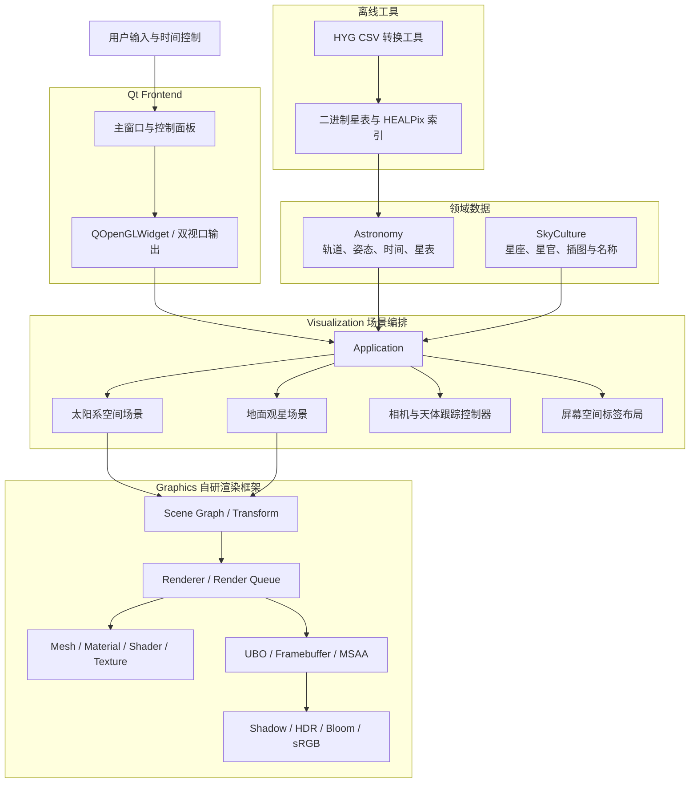
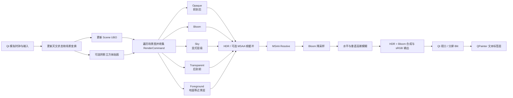
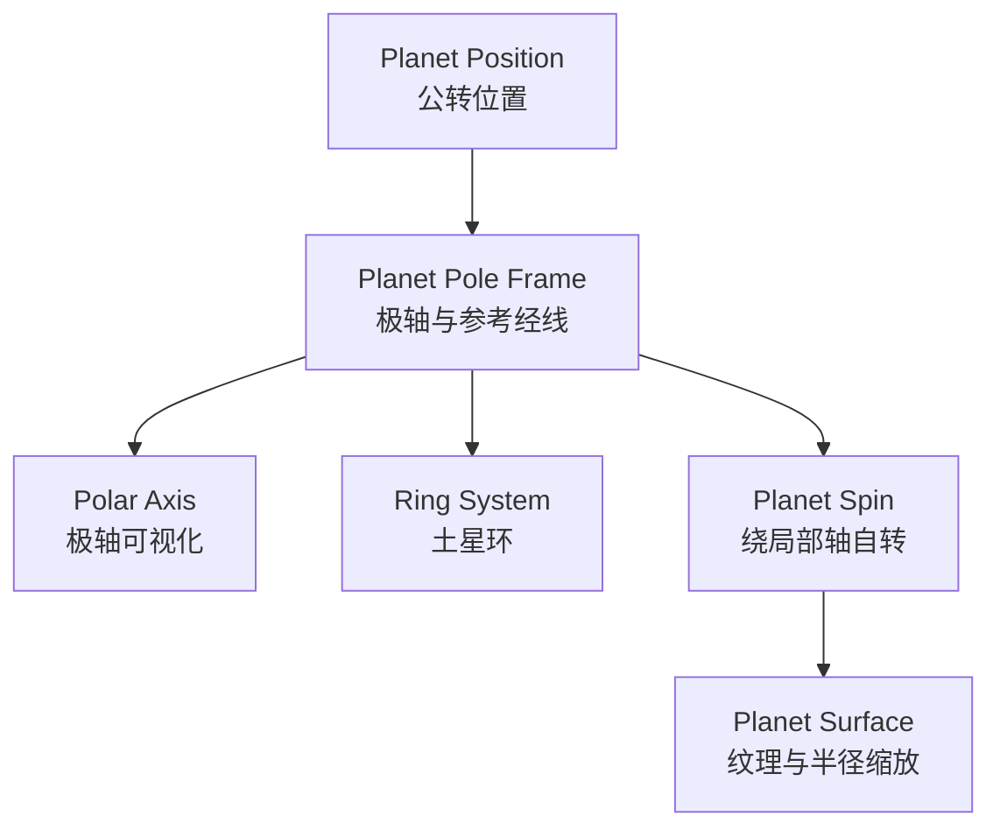
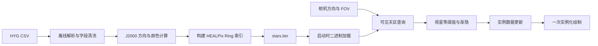

# Kepler

> 基于自研 OpenGL 渲染框架的交互式太阳系与地面观星可视化系统

Kepler 是一个以实时图形学学习为核心的个人项目。项目提供太阳系空间视图、
地面观星视图和双场景分屏模式，并将天文位置计算、星表检索、星座文化数据与
实时渲染结合在同一套桌面应用中。

基础渲染框架由本人手动设计和实现；在框架完成后，项目也被用作一次持续的
Vibe Coding 实践。AI 参与了部分天文功能、Qt 界面、数据处理和跨模块重构，
本人负责需求定义、架构决策、代码审查、调试、测试与最终验收。

> 本仓库仅用于项目展示，不包含完整源码、原始数据和可构建工程。完整源码暂不
> 公开，可在面试过程中展示核心模块及开发历史。

<!--
发布前请完成以下事项：
1. 将截图放入 media/，文件名与下文一致；
2. 将“演示视频：待补充”替换为 Bilibili 或 GitHub 视频地址；
3. 检查截图和视频中是否暴露本地路径、账户信息或私有仓库地址；
4. 确认所有公开图片、纹理和数据的再发布许可。
-->

## 项目演示

**演示视频：** 待补充

| 太阳系空间视图 | 地面观星视图 |
| --- | --- |
|  |  |

| 双场景分屏 | 天体跟踪与星座文化 |
| --- | --- |
|  |  |

## 核心功能

- **太阳系空间视图**：显示太阳、八大行星、月球、轨道和行星自转轴，支持真实
  距离与视觉优化布局、自由空间相机及地球参考系附着。
- **地面观星视图**：根据观察者经纬度构建地平坐标系，显示地面、星空、恒星、
  太阳系天体、赤道、黄道、岁差圆及天球坐标网格。
- **分屏渲染**：空间视图与观星视图可以独立或同时显示；鼠标输入根据所在视口
  分发给对应相机。
- **天体跟踪**：相机平滑转向并锁定太阳、行星或月球；空间视图同步显示地球到
  目标天体的方向关系。
- **时间模拟**：支持实时播放、加速播放、暂停及按小时、日、月、年进行日历单位
  推进；UTC 与 TT 使用同一模拟时刻。
- **星座文化**：支持西方星座与中国星官的连线、名称、边界和插图，并提供附近
  显示、渐隐渐现和逐段绘制动画。
- **双语标签**：太阳、月球、行星、恒星、星座和星官名称可切换中英文；标签在
  屏幕空间进行遮挡规避和渐变。

## 技术栈

| 类别 | 技术 |
| --- | --- |
| 语言 | C++17、GLSL 4.20 |
| 图形 API | OpenGL 4.2 Core Profile、GLAD |
| 桌面界面 | Qt 6、QOpenGLWidget |
| 数学与天文 | GLM、Eigen、ERFA |
| 资源加载 | stb_image、TinyEXR、WebP |
| 数据与配置 | HYG 星表、HEALPix、JSON |
| 构建与依赖 | CMake、Ninja、vcpkg、MinGW |

## 总体架构

项目按职责划分为五个主要模块。Qt 前端只负责窗口、控件、输入和模拟时钟；
Visualization 负责组织两个场景；Graphics 与 Astronomy 保持相互独立，避免将
天文计算直接耦合到 OpenGL 对象中。

### 模块职责

| 模块 | 主要职责 |
| --- | --- |
| `graphics` | 场景图、变换、网格、材质、着色器、纹理、帧缓冲、统一缓冲区、渲染状态与队列 |
| `astronomy` | UTC/TT 时间、太阳系天体位置和姿态、视亮度、HYG 星表及 HEALPix 索引 |
| `skyculture` | 西方星座和中国星官的名称、连线、边界及插图描述 |
| `visualization` | 将天文状态映射到两个可视化场景，管理相机、动画、标签和显示策略 |
| `qt_frontend` | 窗口、分屏输出、鼠标键盘输入、时间与图层控制面板 |
| `hyg_to_kepler` | 将 CSV 星表转换为应用可直接加载的二进制数据 |

## 单帧渲染流程

渲染器先遍历场景图并生成渲染命令，再按材质状态进入不同队列。不透明物体按
前到后排序，透明物体按后到前排序；天空层和前景层使用显式顺序，避免仅靠距离
无法确定叠加关系。

## 关键技术点

### 1. 场景图与天体姿态分层

每个天体使用分层节点分别表示平移、极轴方向、自转和视觉缩放。极轴标记与
土星环只继承极轴方向，行星表面继续继承自转，因此可以独立观察岁差和每日自转，
也避免把物理姿态与网格尺寸混在同一个变换中。

### 2. 多队列渲染与透明物体管理

- 使用 `Opaque / Bloom / Sky / Transparent / Foreground` 队列隔离不同绘制规则。
- 不透明对象前到后绘制，透明对象后到前稳定排序。
- 星座插图、星座线、恒星、行星精灵和行星表面按天空层级组织。
- 土星环使用透明材质、双面光照和片元丢弃，结合深度缓冲减少表面与环的冲突。
- 地面使用独立前景投影，避免为了贴近观察点而将整个场景的近裁剪面设置得过小。

### 3. HDR、Bloom、阴影与抗锯齿

- HDR 场景颜色和 Bloom 提取结果写入不同颜色附件。
- Bloom 经过降采样和水平/垂直高斯模糊，再与 HDR 场景合成。
- 使用深度立方体贴图表现太阳点光源阴影，并允许在界面中关闭阴影开销。
- 支持 1x、2x、4x 和 8x MSAA，最终解析到普通 HDR 帧缓冲。
- 宽线通过几何着色器扩展为屏幕空间带状几何，并在片元着色器中计算边缘覆盖率，
  避免依赖不同驱动表现不一致的 `glLineWidth`。

### 4. 大规模恒星数据处理

HYG 原始 CSV 不在程序启动时直接解析。独立工具先提取恒星名称、J2000 赤经赤纬、
视星等和 B-V 色指数，生成二进制星表并构建 HEALPix 空间索引。运行时只查询与
视锥相交的天区，再按当前视场角对应的极限星等筛选，最终以实例化精灵绘制。

恒星使用固定像素尺度的精灵表示。太阳系天体根据投影后的像素半径，在精灵和
纹理球体之间交叉淡化，从而兼顾广角视图中的可见性和放大后的表面细节。

### 5. 天文状态与时间系统

- 八大行星位置使用完整 VSOP87A 级数。
- 月球相对地球的位置使用 ELP/MPP02 模型。
- 非地球天体姿态使用 IAU 天体定向模型；地球使用长期平均岁差与近似均匀自转。
- 内部统一使用 J2000 TT 秒数；现代日期支持 UTC、闰秒和 TT 转换。
- 历史模拟使用前推格里高利历表示 TT，可在界面中追溯到公元前 2000 年。
- 参考轨道线是固定椭圆可视化引导，不等同于随时间变化的瞬时密切轨道。

### 6. 两种空间尺度策略

真实天文距离与放大的行星网格无法同时直接显示，因此空间视图提供两种布局：

- **真实距离模式**：保留行星距离比例，并统一调整场景单位尺度。
- **概览模式**：保持轨道形状和行星顺序，根据可调间距重新安排轨道带，同时进行
  碰撞安全检查，为行星网格、土星环和未来的小行星带预留空间。

模式切换采用连续插值，避免天体位置瞬间跳变。地面观星视图则以真实方向为核心，
对距离与视觉尺寸分别映射，保证角位置正确且远处天体仍然可见。

### 7. 坐标系与相机

- 空间相机使用四元数累计局部轴旋转，避免欧拉角万向节锁。
- 地面观星模式通过地球极轴、地球自转和观察者经纬度构建 Observer Frame。
- 天体跟踪控制器先平滑获取目标，再保持视线锁定；目标位于地平线下时，地面会
  渐变为半透明，但仍保留“目标在地下”的空间关系。
- 赤道网格和地平网格分别附着于地球极轴参考系与观察者地面参考系。

### 8. 标签与星座文化动画

标签在三维物体渲染后由 Qt 文本层绘制。系统将候选标签投影到屏幕空间，根据
优先级、亮度和矩形碰撞决定显示内容，并对出现和消失进行平滑过渡。

星座或星官可以全部显示，也可以仅显示鼠标附近的单位。附近模式使用进入和退出
两个距离阈值形成滞回区间：进入后从当前进度继续绘制，离开后反向收缩，不会在
阈值附近反复闪烁。

## 个人工作与 AI 辅助边界

### 手动设计和实现

- OpenGL 上下文接入与基础渲染循环。
- Scene Graph、Transform、Mesh、Material、ShaderProgram 等基础抽象。
- 纹理、Uniform Buffer、Framebuffer 与基础相机系统。
- 渲染队列、渲染状态和基础资源管理框架。
- 对实时图形学问题的学习、实验和早期功能实现。

### AI 辅助迭代

- 天文模型和星表数据管线的接入与扩展。
- Qt 控制面板、双场景交互及大量界面状态同步。
- 星座文化、标签、跟踪、动画和部分后处理功能。
- 跨模块重构、自动化测试及重复性代码生成。

### 本人持续负责

- 将想法转化为具体需求并决定实现优先级。
- 审查生成代码，判断模块归属、数据所有权和接口边界。
- 通过编译、测试、视觉检查和 GPU 调试定位问题。
- 修正透明排序、深度冲突、坐标变换、时间同步和性能退化等问题。
- 对最终功能是否符合预期作出验收决定。

## 工程实践

- 使用 CMake 划分静态库模块，并通过 vcpkg Manifest 管理 Eigen、TinyEXR、WebP
  和 nlohmann/json 等依赖。
- 使用 CMake Presets 隔离共享构建配置与本机 Qt、MinGW、vcpkg 路径。
- 为时间转换、行星位置、天体姿态、星表索引、相机控制、帧缓冲和 Qt 控件状态
  编写独立测试。
- 使用 OpenGL 调试输出及 NVIDIA Nsight Graphics 分析着色器、帧缓冲、渲染状态
  和性能问题。

## 项目定位与精度说明

Kepler 的主要目标是学习实时图形学、场景组织和 AI 辅助软件开发，不是专业天文
星历软件。当前模型存在以下边界：

- 轨道和姿态模型内部暂时将 TT 近似作为 TDB 使用。
- VSOP87A 不等同于现代 JPL 高精度星历。
- 地球自转未包含 UT1、章动、极移和历史 Delta-T 修正。
- 行星轨道线用于视觉参考，并不表示当前时刻的瞬时密切轨道。
- 极端历史或未来日期适合观察长期趋势，不应作为高精度观测结果。

## 数据与资源说明

项目涉及 HYG 星表、VSOP87、ELP/MPP02、IAU/PCK 天体定向数据、ERFA、Stellarium
星空文化数据及多来源纹理。公开展示仓库只保留经许可可公开的截图与视频，不重新
分发原始数据或纹理。正式发布前会为每项公开资源补充来源和许可证说明。

## 当前状态

项目仍在持续迭代，当前重点包括：

- 分析和优化大视场与高倍率缩放下的渲染性能；
- 改善行星表面、环系统、星空背景和地面材质；
- 完善数据来源、精度范围及资源许可文档；
- 继续验证 AI 参与中型 C++ 图形项目时的效率与风险。

## 源码说明

完整源码暂不公开。本展示仓库仅包含项目介绍、架构图、截图与演示视频。若需要
进一步了解基础渲染框架、关键算法或开发历史，可在面试过程中现场展示。

